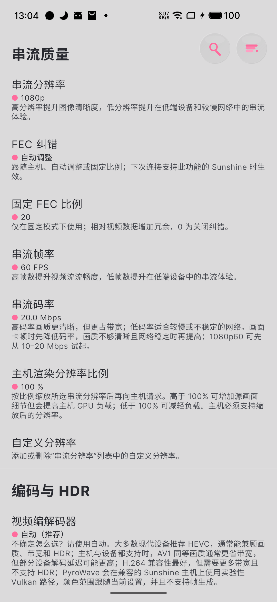

# Android、电视与 Quest

Android Moonlight V+ 面向手机、平板和兼容的电视设备。先完成普通串流，再添加触控布局、麦克风或画面增强。

## 安装与首次连接

1. 从[正式发行页](https://github.com/qiin2333/moonlight-vplus/releases/latest)下载 APK。
2. 在下载提示或文件管理器中打开，按 Android 提示允许该来源的本次安装。
3. 打开应用，让它与主机处于同一网络；显示主机后点击配对，或手动添加主机 IP。
4. 将客户端显示的 PIN 输入 Sunshine 的 PIN 码页面。
5. 选择 Desktop，用基础画质检查画面、声音和操作。

找不到主机时，先检查本地网络权限与设备互通，见[连接排查](../troubleshooting/connection.md)。

## 串流质量设置

在客户端设置中找到“串流质量”，先核对**串流分辨率、串流帧率和串流码率**。下面的实机配置是 1080p、60 FPS、20 Mbps；网络不稳时，先把码率降到 10 Mbps 对比。

<figure class="manual-figure manual-figure-portrait">
  <ScreenshotFocus :source-width="1080" :regions="[[32, 298, 1008, 180], [32, 950, 1008, 150], [32, 1148, 1008, 225]]">
  
  </ScreenshotFocus>
  <figcaption>串流质量设置（魅族 17，Android V+ 12.12.13.beta.6）。点击可看原图；正式版和其他平台的入口可能不同。</figcaption>
</figure>

编码、HDR 和统计字段的调整顺序见[画质设置与性能统计](./settings.md#实机设置示例)。FEC、主机优化等高级选项请按对应章节单独配置。

同一页向下还可找到“主机渲染分辨率比例”，用于改变向兼容主机请求的渲染尺寸；入门先保持 100%，操作与验证见[渲染尺寸与串流尺寸](./settings.md#render-resolution)。

## 串流菜单与退出

进入串流后，通过客户端提供的菜单入口查看画质、触控、麦克风和性能监控选项。菜单的打开方式以安装版本的操作提示为准。

Android V+ **12.13.0** 的两个入口需要区分：

| 菜单名称 | 行为与检查 |
| --- | --- |
| 暂停串流 | 断开当前客户端的串流连接；主机游戏可能继续运行，并非暂停游戏进程 |
| 退出串流 | 受设置中的“‘退出’操作”影响，可选择“同时结束主机应用”或“仅断开连接” |

不同版本的菜单名称可能有所变化。退出前请保存游戏进度，再按“退出”设置与确认提示选择是否结束主机应用。

## 触控与王冠布局

桌面操作可先使用触控板模式，射击或动作游戏再选择适合的相对鼠标、屏幕按键或实体手柄。

当前 V+ 的 **设置 → 王冠 → 管理 Crown 配置** 可建立触屏按键布局。先创建一套适合当前屏幕与游戏的配置，在串流中测试移动、视角、按键和多指操作，再微调。

使用 **超市王冠** 中的社区布局前，核对适配的游戏与设备。屏幕尺寸、长宽比和操作习惯不同，导入后仍可能需要调整；迁移按键布局请使用 Crown 导入入口，完整客户端备份可能包含其他设备的设置和配对身份。

创建、编辑、切换、导出分享及三指键盘手势，按[王冠布局与触控操作](./crown.md)逐步配置。

## 手柄与麦克风

手柄先通过 USB 或蓝牙连接到 Android，确认普通按钮工作后再测试体感、触控板和振动。高级反馈受系统、连接方式、固件和主机端组件影响。

麦克风在串流设置中开启并授予录音权限，还需主机提供相应通道。检查“每次进入串流的初始状态”，避免功能开启但实际仍静音。主机端验证步骤见[声音与输入](../server/audio-input.md)。

音频模拟振动会根据声音生成反馈；它与游戏原生振动、DualSense 原生音频触觉是不同路径。效果不对时先分别关闭，只测试一条路径。

原生 DualSense、HD Haptics 组件与手柄轮盘见[手柄与高级触觉](./controllers.md)；USB 外设交给主机使用是独立的[实验性转发流程](../server/collaboration.md#usb-forwarding)。

## 电视、盒子与 Quest {#tv-and-quest}

- **Android TV / 盒子**：先使用 H.264、1080p、60 FPS 和立体声，确认遥控器或手柄能选择主机与应用；再尝试 HEVC、HDR 或多声道。
- **Quest**：以当前客户端发行说明和设备允许的安装方式为准。先验证普通串流窗口、输入与声音，不把 Android APK 等同于专用 VR／立体串流支持。
- **外接屏**：支持的客户端可在设置中选择把串流发送到外接显示器。先确认普通画面与音频，再提高分辨率和刷新率。

电视的画面处理模式可能增加显示延迟。可以对比设备提供的游戏模式；客户端显示正常 FPS 不等于电视显示阶段没有额外处理。

## 进阶视频与功能范围

PyroWave 能力检测、Vulkan 路径、客户端插帧及弱网补帧见[进阶视频教程](./advanced-video.md)。对照[平台支持](../getting-started/features.md)确认当前路径的限制；普通串流不需要同时开启这些功能。

## 备份与换设备

使用应用的 **备份与同步** 保存设置；完整备份需要妥善保管密码和文件，它可能包含主机配对身份。

原设备恢复时，先检查恢复预览，必要时重新配对。换设备时先重新配对主机，再迁移需要的设置；分享布局只使用 Crown 的导出／分享入口，不公开整份备份。

## 参考

- [Moonlight V+ 功能指南](https://github.com/qiin2333/moonlight-vplus/blob/master/docs/VPLUS_FEATURES.md)
- [备份、恢复与配置分享](https://github.com/qiin2333/moonlight-vplus/blob/master/docs/BACKUP_AND_MIGRATION.md)
- [12.13.0 正式版：菜单与退出设置](https://github.com/qiin2333/moonlight-vplus/blob/v12.13.0/app/src/main/res/values-zh-rCN/strings.xml)
