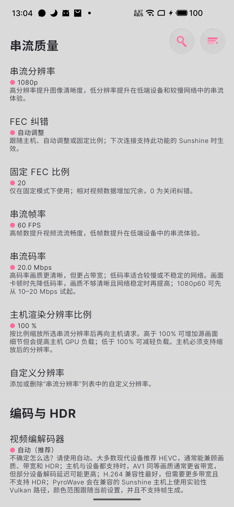
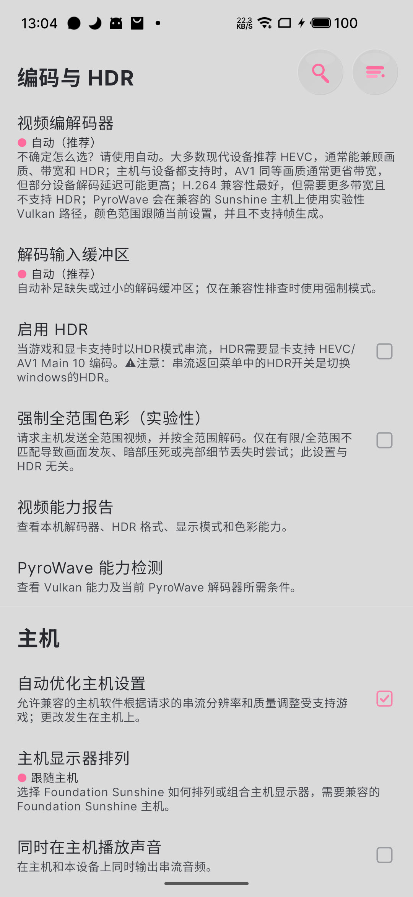

# 画质设置与性能统计

不同设备的最佳设置不同。用一套稳定配置作为对照，再一次改变一个选项，才能判断清晰度、延迟和稳定性的变化来自哪里。

特色功能的设备条件与教程入口见[功能与平台支持](../getting-started/features.md)。

## 建立你的对照配置

| 选项 | 对照起点 | 提高前要确认 |
| --- | --- | --- |
| 分辨率 | 1080p，低性能设备可先 720p | 主机编码、客户端解码和屏幕尺寸 |
| 帧率 | 60 FPS | 客户端刷新率、游戏稳定帧率与链路余量 |
| 码率 | 10 Mbps 起，稳定后比较 20 Mbps | 可用带宽、拥塞和抖动，而不只是宽带标称值 |
| 编码 | 自动或 H.264 | HEVC / AV1 是否走硬件解码 |
| HDR、4:4:4、10-bit | 基础对照时先关闭 | 两端能力和实际协商格式 |
| 音频 | 立体声 / Opus | 输出设备与客户端支持的声道和格式 |
| 额外画面处理 | 先关闭 | 性能余量、额外延迟与兼容性 |

码率越高不一定越流畅。超过可用链路能力会增加排队、丢包或卡顿；降低分辨率和帧率有时比继续提高码率更有效。

## 实机设置示例

以下截图展示魅族 17 上的 **Android Moonlight V+ 12.12.13.beta.6**。正文只展示对应设置的重点区域，点击可看原图；其他平台和正式版的布局可能不同。

  <figure class="manual-figure manual-figure-portrait">
    <ScreenshotFocus :source-width="1080" :regions="[[32, 298, 1008, 180], [32, 950, 1008, 150], [32, 1148, 1008, 225]]">
    
    </ScreenshotFocus>
    <figcaption>分别截取分辨率、帧率和码率。图中码率为 20 Mbps；首次测试可从 10 Mbps 开始，稳定后再比较。</figcaption>
  </figure>
  <figure class="manual-figure manual-figure-portrait">
    <ScreenshotFocus :source-width="1080" :regions="[[32, 288, 1008, 300], [32, 828, 1008, 410]]">
    
    </ScreenshotFocus>
    <figcaption>编码先用自动，建立 SDR 对照时先关闭 HDR。“强制全范围色彩”与 HDR 不同，只在确认范围不匹配时排查；实验性路径不属于入门必开项。</figcaption>
  </figure>

请按下面的步骤选择参数。原图中的 FEC、主机优化等高级选项需要结合网络与设备单独配置，建议先完成基础画质测试。

## 按顺序提高画质

1. 固定一个有持续运动的场景，确认对照配置正常。
2. 先调整码率，看画质和丢包是否改善或恶化。
3. 再提高分辨率或帧率；两者分开测试。
4. 对比 HEVC 或 AV1 的实际解码耗时和画质。
5. 最后启用 HDR、多声道、自适应码率或额外处理。

高刷新率屏幕可先用其支持的 60 FPS，再测试 120 FPS 等目标。主机游戏本身不稳定时，先解决游戏掉帧；客户端插帧不能修复主机输入、网络或捕获的瓶颈。

## 主机渲染尺寸与串流尺寸 {#render-resolution}

Android V+ 12.13.0 及图示版本提供 **主机渲染分辨率比例**；PC V+ 可通过远程分辨率与 AppView 显示控制分别调整渲染和串流尺寸。两端的菜单入口不同，请按所用客户端操作。

1. 先固定串流分辨率和帧率，保持主机比例 **100%**，记录游戏帧率、实际主机分辨率及编码耗时。
2. Android 在串流质量页查找 **主机渲染分辨率比例**，提高一档后重新连接；PC 使用自己的远程分辨率／显示控制入口。
3. 在主机 Windows 显示设置与游戏中确认请求实际生效，再对比细节、帧率和负载。主机渲染更大、传输仍保持原尺寸时，可能以更多 GPU 负载换取细节。
4. GPU 余量不足可尝试更低比例；尺寸异常、裁切或兼容问题时恢复 100% 和原显示策略，重连验证。

主机渲染比例控制主机画面尺寸，与 Windows 文字缩放、客户端插帧的渲染比例分别设置。若只是文字太小，先按[显示缩放说明](../server/display.md)调整。

## 自动码率与丢包保护（FEC）

**Android V+ 12.13.0 / PC V+ 6.5.0** 提供的自动码率与 FEC 是两项独立控制，需要兼容的 Sunshine 主机支持：

| 设置 | 作用 | 调整后注意 |
| --- | --- | --- |
| 自动调整码率（ABR） | 根据网络反馈调整码率 | 观察实际码率、丢帧与画质，不能代替网络互通 |
| 跟随主机 | 采用主机的 FEC 设置 | FEC 更改在下次串流连接生效 |
| 自动调整 FEC | 让兼容主机按网络反馈选择纠错比例 | 不支持时沿用主机默认行为 |
| 固定 FEC 比例 | 指定冗余比例；0% 表示关闭纠错 | 比例越高，保护数据占用的传输预算越多 |

Android 12.13 的正式版名称为“丢包保护（FEC）”，图示测试版中的对应名称为“FEC 纠错”。兼容主机会在目标码率内平衡画质与纠错，固定 FEC 越高，可用于画面本身的码率可能越少；实际网络流量仍会波动。建议从跟随主机或自动 FEC 开始，再根据丢包和画质调整。

这两版客户端还区分**推荐码率**与**手动指定码率**：手动输入后，更改分辨率或帧率会保留该数值。想恢复自动推荐时，使用“恢复推荐”或“使用推荐码率”；改完再检查实际 Mbps，避免误以为提高分辨率会自动获得更高码率。

## 打开性能统计

<ManualDiagram kind="latency" />

在客户端设置或串流菜单里查找**性能统计／性能浮窗**，同时查看 Sunshine 的运行状态或日志。不同客户端的名称、采样窗口和含义不完全相同。

Android V+ 可结合[串流菜单与退出说明](./android.md#串流菜单与退出)操作。先打开统计，再在持续运动的场景中观察下面的项目。

| 观察项目 | 用它回答什么 |
| --- | --- |
| 接收帧率、网络丢帧 | 画面是否及时到达，链路是否稳定 |
| 网络延迟与抖动 | 网络是否排队、波动或经过较长路径 |
| 主机处理／编码耗时 | 服务端是否能跟上目标帧率 |
| 解码耗时与丢帧 | 客户端是否使用合适的解码路径 |
| 渲染／显示相关统计 | 画面是否在客户端队列或显示阶段受阻 |

60 FPS 的帧间隔约 16.7 ms，120 FPS 约 8.3 ms，可用来判断某段处理是否来得及。不要把不同定义的字段直接相加，当作完整的按键到画面延迟。

静态桌面没有持续画面更新时，发送 FPS 可能降低。应在拖动窗口、播放视频或游戏运动场景中判断是否真正卡顿。

## 默认设置不合适时

出现周期性顿挫时，先让游戏帧率与串流目标稳定，再比较客户端默认的同步／帧节奏选项。每次只调整一项，并记录丢帧和延迟变化，再决定是否保留。

已确认是网络瓶颈时，兼容版本可尝试自适应码率，但它不能替代可达性配置，也不能让不足的带宽变大。更多按症状定位的方法见[卡顿与延迟排查](../troubleshooting/performance.md)。

## 参考

- [Foundation Sunshine：性能排查](https://github.com/AlkaidLab/foundation-sunshine/blob/master/docs/zh-CN/faq.md)
- [Moonlight：性能统计字段说明](https://github.com/moonlight-stream/moonlight-docs/wiki/Frequently-Asked-Questions#what-do-the-numbers-mean-in-the-on-screen-connection-statistics)
- [Android V+ 12.13.0：画质与 FEC 设置](https://github.com/qiin2333/moonlight-vplus/blob/v12.13.0/app/src/main/res/values-zh-rCN/strings.xml)
- [PC V+ 6.5.0：远程分辨率与显示控制](https://github.com/qiin2333/moonlight-qt/blob/v6.5.0/README.md#协议与串流能力)
- [PC V+ 6.5.0：ABR、FEC 与码率说明](https://github.com/qiin2333/moonlight-qt/releases/tag/v6.5.0)
