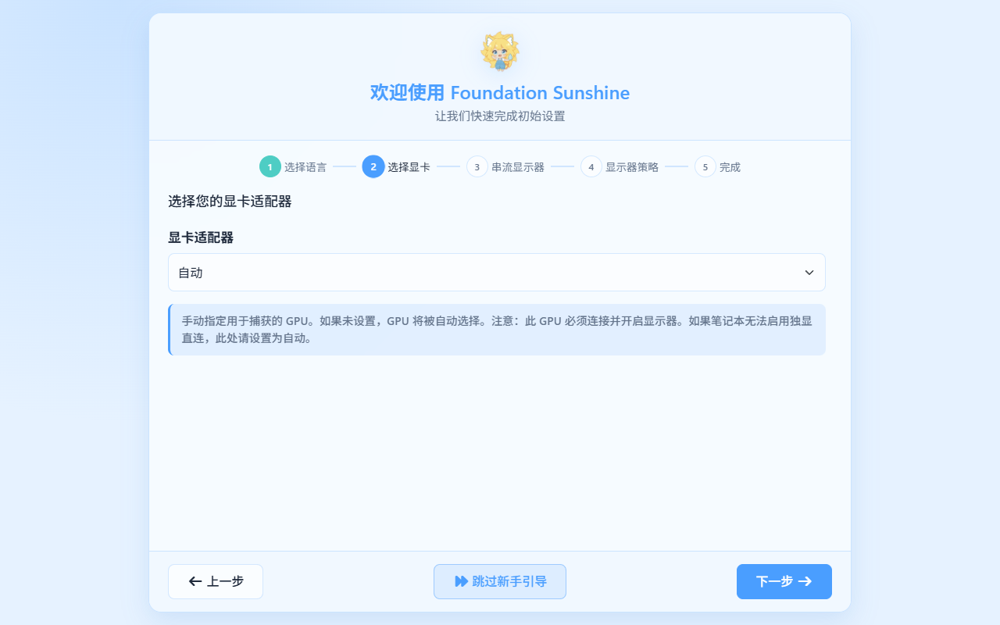
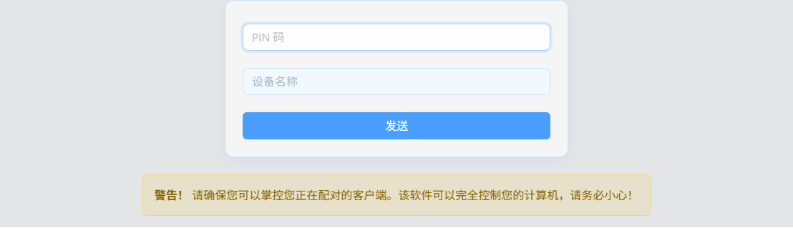

# 第一次串流

游戏运行在 Windows 电脑上，Sunshine 把画面和声音发给手机、平板、电视或另一台电脑；Moonlight 把你的操作传回去。下文把 Windows 电脑叫作**主机／服务端**，手边游玩的设备叫作**客户端**。

欢迎使用 Foundation Sunshine（基地版）和配套 Moonlight 客户端。先按本章完成局域网串流，确认画面、声音和操作正常，再按设备条件开启增强功能。

本手册适用于 [Foundation Sunshine 2026.1011](https://github.com/AlkaidLab/foundation-sunshine/releases/tag/v2026.1011.150654.%E6%9D%82%E9%B1%BC)、[Android V+ 12.13.0](https://github.com/qiin2333/moonlight-vplus/releases/tag/v12.13.0) 和 [PC V+ 6.5.0](https://github.com/qiin2333/moonlight-qt/releases/tag/v6.5.0)。截图在图注中标明版本，测试版界面可能与正式版略有不同。日常使用建议从正式发行入口下载安装包。

<ManualDiagram kind="streaming" />

想先了解基地版与配套客户端能做什么，可查看[功能与平台支持](./features.md)。先完成本页的基础串流，再选择需要的增强功能。

<SunshineTip title="太阳娘的隐藏手势：三指唤出键盘">
  <p>先在记事本里测试触控与键盘，再进游戏配置布局。完整操作见<a href="../clients/crown.html#gestures">触控手势与本地键盘</a>。</p>
</SunshineTip>

## 1. 准备两台设备

- 一台已登录 Windows、能正常运行游戏的电脑，安装 Sunshine。
- 一台手机、平板、电视或其他电脑，安装对应的 Moonlight。
- 两端接入同一个家庭网络。主机优先接网线，无线客户端靠近路由器。

首次测试先用物理屏幕；没有物理屏幕时，按[虚拟显示器](../server/display.md)安装并选择基地显示器。外网、HDR、高帧率和熄屏策略可在基础连接成功后逐项配置。

系统、显卡和网络条件见[开始前的准备](./requirements.md)。

## 2. 安装并打开 Sunshine

1. 在游戏电脑打开[官网的开始使用区域](https://www.alkaidlab.com/#stream-guide)，或进入[Foundation Sunshine 正式发行页](https://github.com/AlkaidLab/foundation-sunshine/releases/latest)。
2. 下载名称以 `WindowsInstaller.exe` 结尾的安装包并安装。首次使用按默认路径安装；需要虚拟屏时保留 Zako Display Driver 组件。
3. 从 Windows 快捷方式打开 Foundation Sunshine 桌面控制面板，按新手向导选择语言、显卡和要串流的显示器。
4. 确认服务正常运行，所选显示器可用。需要补装驱动时使用桌面 GUI 的基地显示器设置或设备中心。

<figure class="manual-figure">
  <ScreenshotFocus :source-width="1280" :regions="[[210, 190, 855, 280]]">
  
  </ScreenshotFocus>
  <figcaption>首次设置向导的显卡选择示例（Foundation Sunshine 2026.1015.51059，界面状态重放）。首次配置可保留“自动”；点击可查看完整向导。</figcaption>
</figure>

桌面控制面板是主要管理入口。可选的浏览器 WebUI 地址是主机上的 `https://localhost:47990`；它用于管理 Sunshine，不能用来观看远程桌面。首次 WebUI 登录与证书提示见[服务端安装](../server/index.md#使用浏览器管理)。

## 3. 安装客户端

根据[客户端选择表](../clients/index.md)安装对应版本。首次启动时，允许系统要求的本地网络访问权限。Android 安装 APK；Windows 选择安装程序；Apple 和鸿蒙设备使用对应项目的发行渠道或应用商店。

## 4. 添加主机并输入 PIN

<ManualDiagram kind="pairing" />

1. 打开 Moonlight，等待主机出现在列表中，然后选择它。
2. 客户端显示 PIN 配对码后，在主机的 Sunshine 管理界面打开 **PIN 码** 页面。
3. 输入本次 PIN 并发送；若界面要求设备名称，填一个方便区分的名字。
4. 返回 Moonlight，确认主机已解锁，并能看到应用列表。

<figure class="manual-figure manual-figure-compact">
  <ScreenshotFocus :source-width="1108" :regions="[[315, 0, 480, 220]]">
  
  </ScreenshotFocus>
  <figcaption>主机端 PIN 配对表单（Foundation Sunshine 2026.1015.51059）。桌面控制面板的“客户端配对”使用同一表单。输入 Moonlight 当前显示的 PIN；配对后，该客户端将获得控制主机的权限，请只为自己信任的设备配对。</figcaption>
</figure>

<SunshineTip title="太阳娘的进阶入口：给不同设备分别校准 HDR">
  <p>手机与电视分别调好自己的参数，换屏后再验证。完成普通串流后，可按<a href="../server/hdr.html#per-device">分设备 HDR 亮度教程</a>操作。</p>
</SunshineTip>

如果自动发现失败，在主机按 `Win + R`，输入 `cmd`，运行：

```text
ipconfig
```

找到正在使用的以太网或 WLAN 适配器的 **IPv4 地址**，在客户端手动添加。例如 `192.168.1.100` 是示例，需要替换为实际地址。客户端填主机地址，不能填 `localhost` 或整个管理网页 URL。

仍然失败时，按[连接与配对排查](../troubleshooting/connection.md)检查网络与权限。

## 5. 使用一套容易验证的画质

在客户端设置中使用下面的起点；服务端先保持自动编码和默认捕获。

| 设置 | 第一次怎么选 |
| --- | --- |
| 分辨率 | 1920 × 1080；小屏也可先用 1280 × 720 |
| 帧率 | 60 FPS |
| 码率 | 10–20 Mbps；网络不稳先从 10 Mbps 开始 |
| 视频编码 | 自动；发生兼容问题时改 H.264 |
| HDR | 关闭，先验证 SDR |
| 音频 | 立体声 / Opus |
| 插帧、超分及画质增强 | 先关闭 |

这套设置便于确认基础连接。成功后，可根据设备性能和网络条件，按[画质设置](../clients/settings.md)逐项提高。

## 6. 连接 Desktop 并确认三件事

在客户端选择 **Desktop**，完成以下检查：

1. **画面**：能看到主机桌面，拖动窗口时画面持续更新。
2. **操作**：鼠标、触控或手柄能控制主机。
3. **声音**：主机播放音频后，客户端能听到声音。

没有 Desktop 时，见[恢复内置应用](../server/apps.md#先连接-desktop)。只在游戏里黑屏时，先回到 Desktop 验证，再检查游戏启动与捕获设置。

## 7. 结束连接，再开始调优

先保存游戏进度，再使用客户端的断开连接入口退出串流。**断开连接不一定会退出正在运行的游戏**；需要关游戏时，先在游戏内退出，或明确使用客户端提供的结束应用操作。

Android V+ 12.13 的菜单使用“暂停串流”和“退出串流”两个名称，其中“退出”的行为还能单独配置，详见[串流菜单与退出](../clients/android.md#串流菜单与退出)。

使用虚拟屏或熄屏策略时，确认连接结束后的 Windows 显示布局符合预期。仍有其他串流会话时，显示器可能继续为它们保留。

完成后，你可以[添加游戏](../server/apps.md)、[设置虚拟屏](../server/display.md)、[开启 HDR](../server/video.md#开启-hdr)，或[配置外网访问](../server/network.md)。

## 参考

- [Foundation Sunshine：安装与首次连接](https://github.com/AlkaidLab/foundation-sunshine#快速开始)
- [Moonlight V+：首次连接指南](https://github.com/qiin2333/moonlight-vplus/blob/master/docs/GETTING_STARTED.md)
