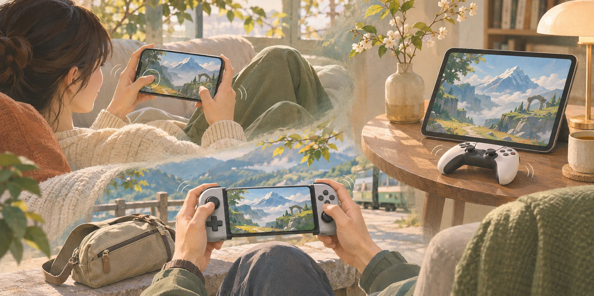
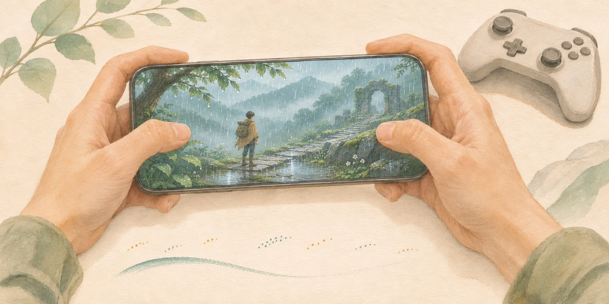

# 振动开发手记：让反馈有轻重，也有分寸

我们希望串流带走的，还有游戏落在手里的感觉。攀爬时扣住岩壁的一拍，行驶时传来的路面变化，雨滴落下时细碎的触感，都在帮助玩家感受动作与环境。换一块屏幕、换一个地方玩，这部分体验也值得尽量留下来。

DualSense（DS）已经能提供出色的原生触觉，为什么还要在模拟上花这么多功夫？合适的手柄配上支持相应反馈的游戏和连接方式，当然是很好的选择。而串流吸引我们的地方，还在于玩家可以按当下的环境决定怎么玩。

有时是在沙发上拿起手机，用屏幕按键玩一会儿；有时出门带一个方便收纳的拉伸手柄；有时手边已经有一只用得顺手的普通手柄。离开电脑桌以后，便携、握持和随手就能开始，都会成为选择设备的理由。我们希望这些选择都能得到认真对待。即使这次没有带 DS，游戏里的动作仍值得有轻重、有节奏地传到指尖。

<figure class="manual-figure">
  
  <figcaption>随手拿起的设备，也值得有用心打磨的反馈。（AI 概念插画）</figcaption>
</figure>

这就是我们愿意在模拟上较真的原因。对一些玩家来说，手机或随身手柄就是平时串流的主要设备，它们的触觉体验值得长期投入。手机马达、普通手柄和支持原生波形触觉的设备，能表达的内容各不相同。完善原生触觉的串流链路、打磨模拟输出，都能帮助玩家手边的设备发挥自己的能力。

真正玩上一段时间，会发现触觉的表现力很大程度上来自差别：轻与重、短与长、持续与间断。一段反馈如果从头到尾都很明显，细小动作就容易被淹没；一次短促冲击如果拖着尾巴，下一拍也会变得模糊。我们在意这些区别能不能留下来，希望玩家自然地感到动作发生了变化，而不必一直注意马达本身。

早期对照《原神》的攀爬反馈时，这种想法就很具体了。本地 DualSense 的反馈是一拍一拍的轻触，手机模拟出来却有“嗡一下”的感觉。当时机身模拟接收的是双通道 Rumble，主要描述高、低频马达的强度，携带的信息与原生触觉波形不同。我们先从已有信息做起：保留弱幅度的区别，让起振和停止及时生效，避免已经结束的动作随后补播。两拍之间能够安静下来，下一拍才有清楚的轮廓。留白同样属于触觉的一部分。

后来，雨落下来的感觉又让我们多想了一步。那轮 DS5 触觉模拟的打磨，从“下雨时还是太用力了”开始。我们期待雨滴带来细碎、轻重有别的触感，让玩家感到环境正在变化。这样的氛围可以轻轻存在，不需要每一滴都像一次明显的撞击。

<figure class="manual-figure">
  
  <figcaption>雨滴有疏密，触感有轻重，间隔也应当留得下来。（AI 概念插画，非实测波形）</figcaption>
</figure>

把总强度调低，是很容易想到的办法。但整段一起变弱，也可能让原本就轻的雨滴先消失，留下的依然是发闷的几下。我们更想保住雨的层次：滴落之间有疏密，单滴之间有轻重，细小的触击能从背景中浮出来，结束后又能退下去。这次的输入是 DS5 触觉 PCM，包含可供分析的波形。我们尝试从中分别保留连续变化的背景与独立短点，再根据设备能力安排输出。

分析这些波形，也让我们重新审视了“清脆”这个目标。雨滴适合短促表达，但缓慢起来的振动、柔和的冲击，也应该保留自己的起伏。强度刚刚上升，并不足以决定它应该成为一次点击。后续分析加入了对短点形态的确认，不符合条件的部分继续按随时间变化的强弱输出。轻柔、持续和清脆，都应该保有各自的质地。

雨景的验证经历了几轮。在联想平板的一次真实串流测试里，已经能感到轻重，但清脆触击与短嗡振还会交替出现。继续完善输出后，一轮包含 144 个事件的客户端雨景回放得到了“轻重可辨，结束干净”的反馈，补充确认时仍有轻度拖尾。持续背景与短点的混合也经过单独复验，点击能够分辨，背景保持连贯。能感到雨滴的层次，是一个具体的进步；接下来还要继续打磨它落下和消退的感觉，并把客户端回放中的改善放回完整串流中复验。

在寻找合适的输出方式时，我们也探索过把音频直接交给 Android 系统生成触觉。这条路线很有吸引力：如果设备能够稳定地完成转换，就有机会简化应用里的分析与输出处理。不过，在目前的测试中，能够启用这项能力的设备还不多；此前测试的联想平板，也没有打通这条通路。我们会继续观察设备与固件的支持情况，验证实际触感、连续性和延迟，再判断它适合哪些场景。在此期间，继续打磨自有分析与模拟输出，可以让更多设备获得可用、可调的反馈。

当手机和手柄一起使用时，我们也希望它们各有所长。手柄已经承担持续反馈，机身再完整复制一遍，可能只是增加重复的底振。早期 Rumble 协同因此尝试让机身补充动作发生时的轮廓，保留手柄的完整信号；后来的分层触觉路径，则进一步尝试由普通振动手柄承担持续层、机身表达独立短点。只有机身时，再根据设备能力合成输出或选择兼容方式。多一个执行器，应该带来有意义的补充，两端合起来也要舒服、自然。

分工是否合适，需要在实际握持中检验。早期我们曾尝试让机身只输出瞬态，实测没有改善，便撤回了这个方案。后来对更完整波形的分析，又为分工提供了新的依据。设备声明支持某种效果，是探索的起点；它是否适合承担游戏里的某一部分反馈，仍要亲手感受。

沿着这个方向，我们也想知道：在某些串流场景里，经过恰当适配的反馈，能否比直接使用原手柄更容易感知细节、更贴合当下的握持方式？例如，持续背景中的轻微触击，是否能通过机身的补充变得更容易分辨。某一拍更容易察觉、长时间玩起来更舒服，都是值得追求的改善，也与原始波形的还原精度属于不同维度。这需要用同一段内容、相近的主观强度和实际握持对照来判断。目前的验证还不足以支持模拟整体超过 DS 原生触觉的结论，但这种针对具体场景的探索，值得继续。

为此，我们把输入分析、输出分配和设备渲染分开，方便追踪每次调整究竟改变了什么。软件回归确认弱幅度、短脉冲、停止和归零这些基础行为，实机比较则回答另一部分问题：每一拍能否分清，背景是否连贯，停止后是否还有余振。早期攀爬记录里的同场景比较仍有待完成，雨景和混合反馈已有部分实机回放结果。我们会把这些范围写清楚，逐步积累对不同设备的理解。

我们想做出的触觉，是有层次、合时宜，也懂得适时安静的反馈。重的一下有力度，轻的一下留得住，雨落时有细碎变化，停下来时也能收得住。无论今天拿起的是 DS、随身手柄，还是只用一部手机，我们都希望在设备能力允许的范围内，把这份感觉做好。玩家可以自在地选择在哪里、用什么玩，再把注意力放回游戏，这也是我们理解的串流体验。

> 本文整理于 2026 年 11 月 5 日，依据 2026 年 8—10 月的开发与验收记录，包括[早期协同路由](https://github.com/cjcxj/moonlight-qiin2333/commit/e6db49c8724b2b30497670c38a6e020b15b72d43)、[弱幅度与起停调整](https://github.com/cjcxj/moonlight-qiin2333/commit/d586caa0c7fc241f5b53768c7f70c4da4d7e6b32)、[攀爬触击验证记录](https://github.com/cjcxj/moonlight-qiin2333/blob/d586caa0c7fc241f5b53768c7f70c4da4d7e6b32/docs/COORDINATED_RUMBLE_VALIDATION.md)，以及后续的[短点形态分析](https://github.com/AlkaidLab/moonlight-audio-haptics/pull/7)、[主机分析接入](https://github.com/AlkaidLab/foundation-sunshine/pull/1199)与[客户端混合输出和验收](https://github.com/qiin2333/moonlight-vplus/pull/785)。当前配置方法见[手柄、扳机与触觉手册](./clients/controllers.md)。
