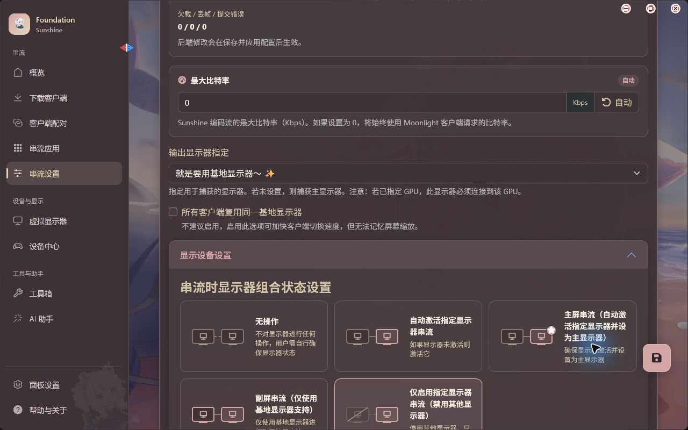

# 编码、画质与 HDR

先让 SDR 桌面串流稳定，再调整编码、HDR 和增强处理。客户端的选项代表请求，最终使用的格式还需要服务端和硬件支持；以实际性能统计和日志为准。

## 选择视频编码

| 格式 | 适合什么时候尝试 | 前提 |
| --- | --- | --- |
| H.264 | 首次连接、电视盒子或兼容问题排查 | 两端普遍支持，先验证硬件解码 |
| HEVC / H.265 | 稳定连接后比较画质与带宽，或准备 HDR | 主机能编码，客户端能及时硬件解码 |
| AV1 | 两端具备相应硬件能力时做对比 | 显卡和终端支持相应编码／解码路径 |

不要仅按显卡年代或手机宣传参数判断。检查实际使用的编码器和解码器；如果格式切换后开始卡顿或黑屏，退回已验证的格式，再检查硬件能力。

客户端控制分辨率、帧率和码率；服务端负责捕获与编码。首次保留自动选择，只有确认选错 GPU 或编码器时再指定。

<figure class="manual-figure">
  <ScreenshotFocus :source-width="1280" :regions="[[315, 124, 886, 126]]">
  
  </ScreenshotFocus>
  <figcaption>服务端实机路径：“串流设置”→“音频/视频”。图中“最大比特率”0 表示采用客户端请求值；它不是客户端的分辨率、帧率和码率设置页。取自本机 2026.1015.51059，截图保留当时现值，没有保存更改。</figcaption>
</figure>

<SunshineTip title="太阳娘的遥控技巧：串流里调用超级指令">
  
在 Foundation Sunshine 事先配置好远端命令后，Android V+ 可从“串流菜单 → 超级指令”调用，适合把常用的主机操作做成固定入口。列表为空时先检查主机端配置。

  
若只是网络突然变差，直接用同一菜单里的“调整码率”降低码率后观察，省去返回设置页的步骤；其他参数是否需要重连，以当前客户端提示为准。

  <a class="tip-source" href="https://github.com/qiin2333/moonlight-vplus/blob/799f50d6e7bd288cd69fe6df2081c9d9502c45b4/docs/VPLUS_FEATURES.md#串流时控制-foundation-sunshine">查看串流菜单功能说明 ↗</a>
</SunshineTip>

## 捕获方式

正常使用先保持默认设置。需要更改时，按目标选择并查看日志确认实际路径：

| 路径 | 适用场景 |
| --- | --- |
| Zako Direct | 当前版本支持时，直接捕获基地虚拟显示器 |
| Desktop Duplication | Windows 桌面捕获与兼容性回退 |
| Windows Graphics Capture（WGC） | 按版本支持捕获桌面或指定窗口 |

WGC 的窗口捕获需要用户模式，不能在 SYSTEM 服务模式下直接使用。具体运行模式按当前 GUI 和项目说明设置，不要复制早期教程的停止服务命令当作通用安装步骤。AMD Display Capture 不适用于基地虚拟屏。

捕获失败时，先恢复默认／自动路径；选定窗口被关闭、最小化或权限不匹配时，也要回到 Desktop 对照测试。

## 开启 HDR

1. 确认主机目标屏幕可以输出 HDR；使用虚拟屏时，先完成驱动和显示设置。
2. 确认客户端系统、屏幕、解码器和所选应用支持对应 HDR 格式。
3. 在客户端启用 HDR，服务端选择合适的 HDR 与显示策略，然后重新连接。
4. 用已知支持 HDR 的内容测试，查看客户端的实际视频格式、显示状态和回退提示。
5. 画面稳定后，再调整目标亮度或进行校准。

**服务端显示已协商或已注入元数据，不等于终端屏幕已经按相同格式原生显示。** HDR10、HDR10+、HDR Vivid 和 Dolby Vision 的条件不同，不能因为手机支持其中一种就推断其他格式也支持。

Foundation 的配对设备设置可按当前版本使用客户端上报亮度或手动配置；需要校准时，结合目标屏幕与 Windows HDR Calibration 配置处理。先保留默认值，不要照抄另一台屏幕的亮度、ICC 或黑位参数。

出现发灰、过曝、偏色或黑屏时，先关闭 HDR 验证 SDR，再按[显示异常排查](../troubleshooting/black-screen.md)逐段定位。Dolby Vision 的开发背景可阅读[技术手记](../dolby-vision-dev-journal-zh.md)。

## 逐项尝试增强功能

RTX HDR、DLSS NR、客户端超分和帧生成会引入额外处理与兼容条件。只启用当前安装版本明确提供、组件状态正常的选项，先用同一场景比较画面和延迟。

RTX HDR 用于将 SDR 内容转换为 HDR，不用于重复处理已有原生 HDR / HLG 输入。出现异常时先关掉新增处理，回到普通路径。实验性编码路径也应在普通串流正常后再尝试。

**Android V+ 12.13.0 的 PyroWave 限制：**该版新增 Vulkan 解码与 HDR 呈现，但发行说明明确表示暂不支持 HDR10+／Dolby Vision 等动态 HDR 元数据，也不支持帧生成。不要把其他解码路径的功能直接套到 PyroWave；需要这些功能时，回到当前客户端明确支持它们的普通路径，并核对实际输出格式。后续版本按各自发行说明复核。

调优方法见[画质设置与性能统计](../clients/settings.md)。

## 参考

- [Foundation Sunshine：画面、捕获与编码](https://github.com/AlkaidLab/foundation-sunshine/blob/master/docs/zh-CN/features.md)
- [Moonlight V+ for PC：格式与硬件能力](https://github.com/qiin2333/moonlight-qt#画质与性能)
- [Android V+ 12.13.0：PyroWave 已知限制](https://github.com/qiin2333/moonlight-vplus/releases/tag/v12.13.0)
